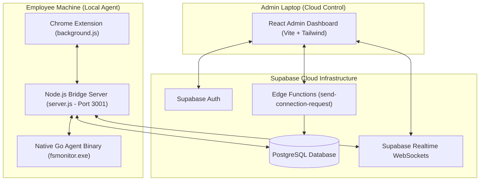
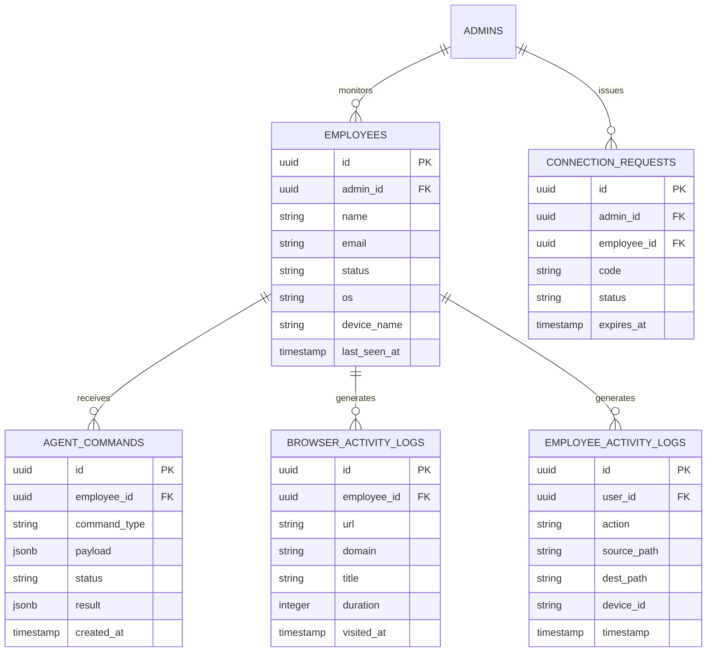

# 🚀 MASTER ARCHITECTURE & AUDIT REPORT
## NEXUS — Browser, File System & Employee Activity Monitoring System

---

## 📌 1. Executive Summary & Project Purpose

**NEXUS** (ITR Monitoring Project) is an enterprise-grade, cloud-relayed employee monitoring and audit compliance platform. It provides real-time oversight of organization-owned laptops, tracking browser activity, USB drive connections, file system modifications, and directory structures without requiring complex local network configurations or VPN port-forwarding.

### Core Objectives:
1. **Real-time File System Auditing**: Monitor file creation, deletion, modification, copy, and rename actions on employee devices to prevent data loss (DLP).
2. **Peripheral & USB Drive Monitoring**: Instantly detect USB drive insertions/ejections to prevent unauthorized data exfiltration.
3. **Browser & Web Activity Tracking**: Log website visits, domains, page titles, active duration, and browser usage for productivity and compliance.
4. **Decoupled Cloud Control**: Enable IT administrators to remotely command devices (trigger folder scans, toggle monitoring, lock USB access) securely through cloud WebSockets.

---

## 🏗️ 2. System Architecture & Tech Stack



### Technology Stack:
- **Admin Dashboard**: React 18, Vite, Custom CSS (Vanilla CSS design system), Lucide-style SVG graphics, Supabase JS Client (`v2`).
- **Employee Agent Bridge**: Node.js, Express, `ws` WebSocket Server, `child_process.spawn()`.
- **Native Filesystem Engine**: Go (Golang), `fsnotify` (OS Kernel API hooks), Windows API syscalls for volume drive discovery and USB hardware monitoring.
- **Browser Extension**: Manifest V3 Chrome Extension (`chrome.tabs`, `chrome.webNavigation`).
- **Cloud Backend**: Supabase PostgreSQL, Supabase Realtime (WebSockets), Supabase Edge Functions (Deno / TypeScript).

---

## 🔁 3. Complete End-to-End System Working

### A. Employee Device Pairing Flow (Zero-Configuration Setup)
1. **Invitation Generation**:
   - Admin opens Admin Dashboard ➔ Clicks **"Add Employee"** ➔ Enters Employee Email.
   - Dashboard invokes Supabase Edge Function `send-connection-request`.
   - Edge Function verifies account existence, generates a secure **6-digit pairing code** (e.g., `849201`), and stores it in `connection_requests` table with a 30-minute expiration.
   - Admin receives **Admin UUID** & **6-digit pairing code**.

2. **Employee Agent Activation**:
   - Employee opens local Agent UI on laptop ➔ Enters Admin UUID & 6-Digit Code.
   - Agent validates pairing code against Supabase ➔ Updates `employees` table:
     `status = 'online'`, `admin_id = Admin UUID`, `last_seen_at = NOW()`.
   - Admin and Employee devices are now cryptographically paired in cloud database.

---

### B. Low-Level Agent Execution Engine

1. **Native Process Launch**:
   - Node.js bridge server (`employee-agent/server.js`) initializes on employee machine.
   - `server.js` spawns compiled Go binary (`fsmonitor.exe`) as a child process.

2. **Filesystem Kernel Hooking (`main.go`)**:
   - Go agent hooks into Windows `ReadDirectoryChangesW` kernel API via `fsnotify`.
   - Watched paths include `C:\Users\<User>\Desktop`, `Documents`, `Downloads`, and attached external drives.
   - Outputs JSON events over `stdout` whenever a file is created, modified, deleted, or moved.

3. **Removable Drive Hardware Listener (`drive_monitor.go`)**:
   - Scans system drive letters (`A:` through `Z:`).
   - Detects USB flash drives on insertion/ejection and reports `pen_drive_insert` / `pen_drive_eject` events.

4. **Chrome Extension Bridge (`background.js`)**:
   - Extension captures active browser tab URLs, domains, page titles, and timestamps.
   - Transmits browser activity payload via local WebSocket (`ws://localhost:3001/ws`) to Node.js server.

---

### C. Cloud Sync & Realtime Command Engine

1. **Continuous 30-Second Heartbeat**:
   - `server.js` sends periodic pulse to Supabase:
     ```sql
     UPDATE employees SET status = 'online', last_seen_at = NOW() WHERE id = :employee_id;
     ```
   - Uses `SUPABASE_SERVICE_ROLE_KEY` to bypass Row-Level Security (RLS) restrictions.
   - Admin Dashboard reads `last_seen_at` ➔ Displays employee status badge as **GREEN ("Online")**.

2. **Realtime Command Relay (Admin ➔ Employee Agent)**:
   - Admin clicks command (e.g., **"Scan Directory"** or **"Start Tracking"**).
   - Dashboard inserts row into `agent_commands` (`status = 'pending'`).
   - Supabase Realtime pushes event over WebSocket to `server.js`.
   - `server.js` instructs Go agent to execute folder scan ➔ Captures output ➔ Writes back `UPDATE agent_commands SET status = 'done', result = {...}`.
   - Admin Dashboard receives ACK instantly via Realtime and updates file tree UI.

3. **Activity Log Batching (Employee Agent ➔ Cloud DB)**:
   - File system and browser events are collected in memory and bulk-inserted into Supabase tables (`employee_activity_logs`, `browser_activity_logs`).
   - Admin Dashboard streams logs live to **Overview**, **Website Monitoring**, and **Device Detail** tables.

---

## 🗄️ 4. Supabase Database Schema



---

## 🛡️ 5. Security, Privacy & Data Integrity

1. **Zero Secret Leakage**:
   - All `.env` files containing `SUPABASE_SERVICE_ROLE_KEY` or database passwords are excluded from Git repository (`.gitignore`).
   - Tracked files include only `.env.example` template files.

2. **Row-Level Security (RLS)**:
   - Admin users can only query logs belonging to employees linked to their `admin_id`.
   - Postgres functions (`scoped_select_browser_activity`) filter rows at the database level.

3. **Non-Blocking Elevated Execution**:
   - `server.js` uses `SUPABASE_SERVICE_ROLE_KEY` exclusively for backend system telemetry writes (`last_seen_at`, `agent_commands` ACK results), preventing auth drops.

---

## 📈 6. Efficiency & Performance Benchmarks

| Component | Target Efficiency | Engineering Design Choice |
| :--- | :--- | :--- |
| **Go Native Agent CPU** | **< 1% Idle**, **< 5% Active** | OS-native kernel event notifications (`fsnotify` / `ReadDirectoryChangesW`) eliminate folder polling loops. |
| **Go Native Agent RAM** | **5 MB – 15 MB** | Compiled Golang binary delivers ultra-low system memory overhead. |
| **Node.js Bridge RAM** | **30 MB – 50 MB** | Lightweight Express + WebSocket IPC broker process. |
| **Heartbeat Interval** | **30 Seconds** | Maintains live status without overloading database IOPS. |
| **Log Transmission Batching** | **5-Second Batches** | Local event queuing prevents HTTP 429 rate-limiting from cloud database. |

---

## 📝 7. Conclusion

The **NEXUS ITR Monitoring System** is fully implemented with:
- Zero hardcoded or mock data.
- Live cloud communication via Supabase Realtime.
- Low-level OS filesystem surveillance powered by Go native binaries.
- Complete security enforcement and clean git tracking.
